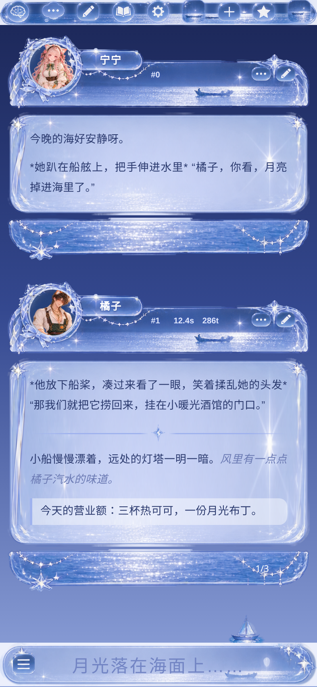

# 月光海·玻璃（酒馆美化）

宁宁 × Claude 自制的 SillyTavern 手机端美化。素材都是透明底 PNG，放在这个文件夹里，通过 jsDelivr 引用。

- 导入：酒馆 → 用户设置 → UI 主题 → 导入 `月光海·玻璃.json`
- 调位置、颜色：改 `src/theme.css` 开头 `:root` 里的变量，然后运行 `python3 src/build.py` 重新生成 JSON
- 链接前缀：`https://cdn.jsdelivr.net/gh/Ttsningning/orange-shop-assets@main/theme/moonsea/`

| 文件 | 用在哪 |
|---|---|
| bubble_top / bubble_mid / bubble_bot | 消息气泡的头部、正文（九宫格拉伸）、尾部 |
| topbar / input_bar | 顶栏、输入框 |
| btn_* | 输入框按钮：菜单、扩展、发送、停止 |
| ico_* | 编辑、更多、星标、箭头、勾叉、顶栏图标 |
| frame_circle / frame_cloud / frame_moon | 备用头像框 |
| deco_* / spinner / btn_loadmore / panel_scene / tile_sea* | 装饰、加载图标、加载更多按钮、场景小图 |

